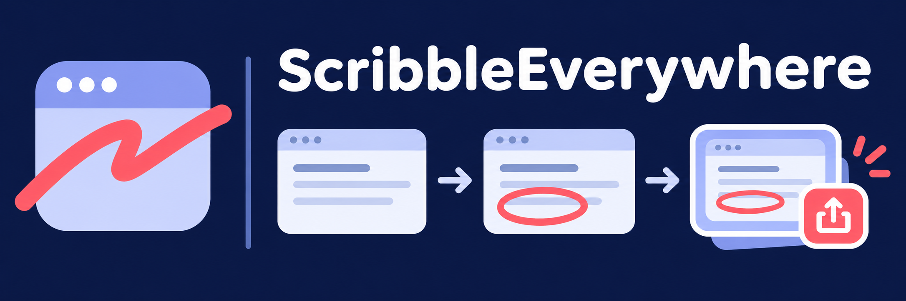
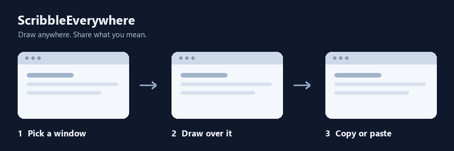

# ScribbleEverywhere



**Draw over your screen. Copy the moment. Share what you mean.**

ScribbleEverywhere is an experimental desktop annotation app for **Windows,
macOS, and Omarchy/Hyprland**. Sketch over a window with a pen or pointer, then
copy the window with your ink or paste it into another app. Use it to explain
an idea, mark up a design, or give an AI visual context.

**Source preview, version 0.1.0.** Build instructions are below. This initial
public version does not include prebuilt downloads. Windows pen, pressure,
finger input and a palm-rest check have been reported working on one device.
Installer acceptance, broader hardware coverage and current macOS/Linux
interactive checks remain open.

[Build & run](#build--run) · [Platform notes](docs/PLATFORMS.md) ·
[Validation](docs/VALIDATION.md) · [Packaging](docs/RELEASING.md) ·
[Privacy](docs/PRIVACY.md)



*Artwork illustrates the workflow. It is not a screen recording.*

## What it does

- Draw on a transparent overlay with a pen, mouse or supported touch input.
- Copy the focused window with your ink, or copy and paste it into a chosen app.
- Undo, clear, keep ink between annotation sessions, and save annotation images.
- Choose ink colours, delivery action, paste target and other platform settings.

While annotating: **⌘Z** undo, **⌘⌫** clear, **⌘C** copy,
**⌘↩** copy and paste, **Esc** stops and retains ink. Windows and Linux use
the same chords with Ctrl. The default global shortcut is **⌥⌘D** on macOS
and **Ctrl+Alt+D** on Windows. Linux needs a Hyprland binding configured by you.

## Platforms

| Platform | Desktop interface | Current limits |
|---|---|---|
| Windows x64 | System tray, transparent overlay, native settings | Single-device input evidence; multi-display, third-party paste compatibility and installer lifecycle checks remain open. |
| macOS 14+ | Menu bar, transparent overlay, native settings | Native automated results exist for earlier revisions; current interactive and distribution checks remain open. |
| Omarchy / Hyprland | Wayland overlay, optional bar widget and command line | Requires a compatible Wayland/Hyprland session and system tools; current live desktop checks remain open. |
| Linux / X11 | Not implemented | No X11 backend. |

See [validation](docs/VALIDATION.md) for the distinction between historical
automated results, reported device testing, and checks still needed.

## Build & run

Clone this repository:

```sh
git clone https://github.com/matthewhand/scribble-everywhere.git
cd scribble-everywhere
```

### Windows

Requires Swift 6 for Windows and Visual Studio 2022 Build Tools with the
Desktop development with C++ workload. From PowerShell:

```powershell
powershell -ExecutionPolicy Bypass -File scripts/build-windows.ps1 -RunTests -NoInstall
```

Remove `-NoInstall` to install the built app under
`%LOCALAPPDATA%\PalimpsestInk`. To produce an unsigned portable ZIP without
installing:

```powershell
powershell -ExecutionPolicy Bypass -File scripts/build-windows.ps1 -RunTests -Portable
```

The ZIP includes Swift runtime DLLs but stores settings and annotations in your
user profile. An experimental per-user MSI script is available.
[Packaging notes](docs/RELEASING.md) describe the uncompleted install, upgrade,
uninstall and clean-machine checks. No signed Windows distribution is provided.

### macOS

Requires macOS 14 or newer and a Swift 6 toolchain.

```sh
./scripts/make-app.sh
./run.sh
```

The app is assembled under
`~/Library/Application Support/PalimpsestInk/`.
Use `./run.sh --build` after source changes. Grant Screen Recording for
capture and Accessibility for targeting/paste in System Settings.

Local builds use an existing local signing identity when available, or ad-hoc
signing. These are not Developer ID signing or notarization. The optional
`scripts/make-signing-cert.sh` creates and trusts a local code-signing
certificate in your login keychain; review it before use.
See [macOS permission troubleshooting](docs/TCC-TROUBLESHOOTING.md).

### Omarchy / Hyprland

Requires Swift 6, a compatible Wayland development environment,
`wayland-scanner`, `libwayland`, `libpng`, `grim`, `wl-copy`,
`wtype` and Hyprland. The optional bar widget also needs Omarchy's Quickshell
environment.

```sh
./scripts/build-linux.sh
# Optional bar widget:
./scripts/install-omarchy-applet.sh
```

Commands install under `~/.local/bin`. The executable
`scribbleeverywhere` is both daemon and control client;
`scribbleeverywherectl`, `palimpsest-ink` and `palimpsestctl` aliases
remain available. Configure a Hyprland key binding, for example:

```ini
bind = SUPER ALT, D, exec, scribbleeverywherectl toggle
```

Useful commands include `toggle`, `copy`, `paste`, `undo`, `clear`,
`save`, `history`, `status` and `quit`. Idle pen-button support may
require additional input-device permissions. Review
`scripts/install-linux-stylus-access.sh` before changing udev access.
See [platform notes](docs/PLATFORMS.md) for dependencies and limits.

## Local validation

On macOS or Linux:

```sh
bash scripts/check-version.sh
bash scripts/validate-native.sh
# Linux archive fixtures only, no Swift or desktop required:
bash scripts/check-packaging.sh
```

On Windows, use `scripts/build-windows.ps1 -RunTests -NoInstall`.
Native tests must run on their target OS. Automated tests do not replace
physical pen, touch, display or paste-destination checks.

This public repository includes no hosted CI workflows.
[Local validation guidance](docs/CI.md) lists the available checks.

## Architecture and compatibility

A Foundation-only Swift core (`PalimpsestCore`) contains geometry, strokes,
palettes and image compositing. Native shells provide AppKit/ScreenCaptureKit,
Win32, and Wayland/Hyprland integration.

Formerly Palimpsest Ink. Internal Swift module names, the macOS bundle identity,
settings locations, saved annotations and startup identifiers retain legacy
names for compatibility. This is a clean public source snapshot, without
private development history or device logs.

The optional [waltop-osx](https://github.com/matthewhand/waltop-osx) pressure
shim supports specific WALTOP tablet setups on macOS. Tablet and button
compatibility varies by driver and device.

## Privacy

Screen captures may contain sensitive information. Check the selected window,
paste destination and saved annotation folder before sharing. Copy/paste sends
an image to the app you choose; that app's own privacy rules then apply.
See [privacy and local storage](docs/PRIVACY.md).

## Contributing

See [open acceptance work](TODO.md). Include your OS, app version and reproduction
steps in bug reports, and remove sensitive captures, file paths and log content.
Please do not upload credentials or personal screen contents.

## License

MIT. See [LICENSE](LICENSE) and [third-party notices](THIRD_PARTY_NOTICES.md).
